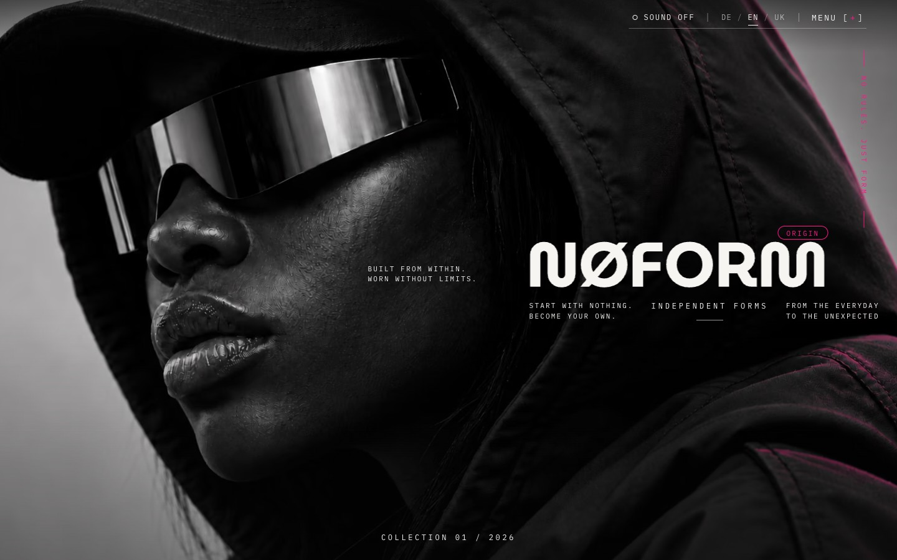

# NØFORM



A fictional streetwear concept site, made as a portfolio piece by [Volodina Web Studio](https://github.com/Kristin198689). One long scroll of full-screen scenes, a strict monospace type system and a restrained palette. There is no shop, no accounts, no forms, no analytics and no backend.

**Live demo:** https://noform-drab.vercel.app

## Highlights

- **Scroll-driven scenes**: GSAP ScrollTrigger and Observer run a sequence of full-screen scenes instead of a page of sections.
- **Motion studies** built as separate experiments before they joined the site: a lettering ring, a helix archive and a depth flight.
- **A motion director** (`src/components/MotionDirector.tsx`) that coordinates scene timing, the preloader and the sound toggle, with reduced-motion fallbacks.
- **Three languages** (German default, English, Ukrainian) with local fonts through `next/font/local`. The display face has no Cyrillic, so Ukrainian headings switch to a different font on purpose.
- **Checked on real viewports**: `qa-report/` holds before/after screenshots for desktop 1440, mobile 360 and 390, WebKit on iPhone, the 404 page and reduced motion.

## Stack

Next.js 16 (App Router), React 19, strict TypeScript, CSS Modules, GSAP (ScrollTrigger, Observer), local WOFF2 fonts. Node 20.9 or newer.

## Run it

```bash
npm install
npm run dev        # http://localhost:3000 (redirects to /de)
npm run build && npm start
npm run lint && npm run typecheck
npm run images     # rebuilds the web image derivatives from the source photos
```

## Routes

`/de` (default), `/en`, `/uk`.

## How it was directed

`CLAUDE.md` and `NOFORM_Claude_Package/` contain the project rules, the visual brief and the decision history. The brief wins over general style advice, and the rules forbid invented studio data, reviews or clients. It is a record of how I direct Claude Code on a design-led project.

## Notes

The numbers shown on the layouts are decorative codes, not product measurements. Photos in the package are concept imagery.
